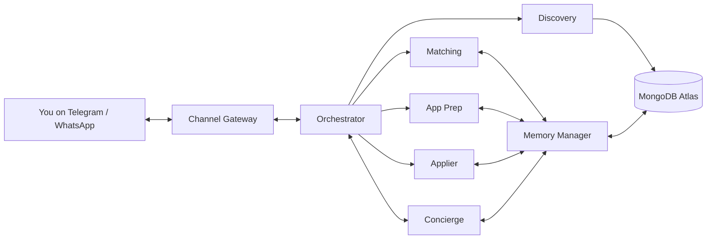

# Job Hunt Agents

A chat-controlled, multi-agent system that finds roles matching your background on the careers pages of companies you choose, and applies to them on your behalf. A dedicated **Memory Manager** learns your details and preferences so it only asks you for things it doesn't know.

> **Status: Phase 0, design review.** No code yet. Development starts after the designs below are approved.

## How it works (one paragraph)

You chat with a bot (Telegram first, WhatsApp/Slack pluggable). You upload your resume once and send a list of companies with their careers URLs. The **Discovery Agent** lists every open role (public ATS APIs first, browser crawl as fallback). The **Matching Agent** scores each role against your profile and sends you a shortlist with reasons. When you tap **Apply**, the **Prep Agent** resolves every form field from memory and asks you, in one batched message, only for what's missing. The **Applier Agent** fills the form in a real browser and, in **review mode**, waits for your ✅ before submitting. **Auto mode** can be switched on later, with strict gates and caps.

## Design documents

| # | Document | What's inside |
|---|----------|---------------|
| 01 | [System Architecture](docs/01-system-architecture.md) | Goals, layers, components, discovery and matching strategy, modes, pluggable LLMs, deployment, key decisions |
| 02 | [Data Flows](docs/02-data-flows.md) | Sequence diagrams for onboarding, discovery, matching, the missing-info loop, submission, and the application state machine |
| 03 | [Agent Specifications](docs/03-agents.md) | Contract for each agent: inputs, outputs, tools, rules, failure handling |
| 04 | [Memory Manager](docs/04-memory-manager.md) | Research summary, memory taxonomy, sensitivity tiers, write and read paths, field resolver, consolidation, API |
| 05 | [Data Model](docs/05-data-model.md) | MongoDB collections, indexes, encryption and retention |
| 06 | [Channels and Costs](docs/06-channels-and-costs.md) | Telegram vs WhatsApp vs Slack pricing, running cost estimate |
| 07 | [Security and Guardrails](docs/07-security-and-guardrails.md) | Threat model, honesty rules, human-in-the-loop points |
| 08 | [Roadmap](docs/08-roadmap.md) | Phases, exit criteria, proposed repo layout |

## Proposed stack

Python 3.12 · FastAPI · LangGraph · LiteLLM (Claude / OpenAI / Gemini, per task) · MongoDB Atlas + Vector Search · Redis + Arq · Playwright (+ browser-use fallback) · Docker Compose · Langfuse

## Open questions for review

1. **Channel:** OK to start with Telegram and add WhatsApp (Meta Cloud API) in Phase 3?
2. **Auto-mode gates:** defaults are score ≥ 80, at most 10 applications a day, at most 2 per company per 30 days. Change any of these?
3. **EEO / diversity questions:** default to "Prefer not to say"?
4. **Cover notes:** generate only when the form asks for one, or for every application?
5. **Re-scan frequency:** every 24 h per company?
6. **Hosting:** a small VM you own, or a managed container platform?
