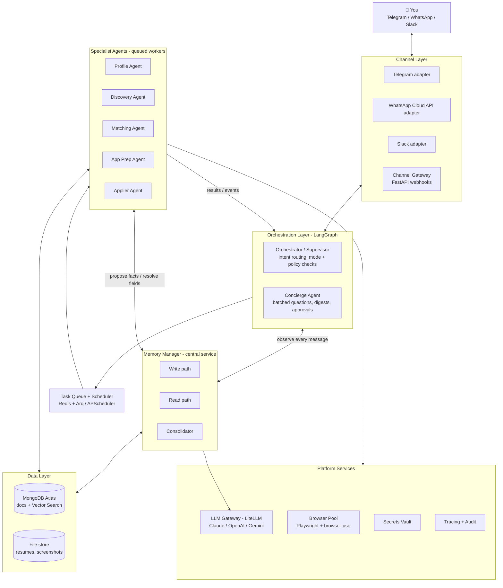
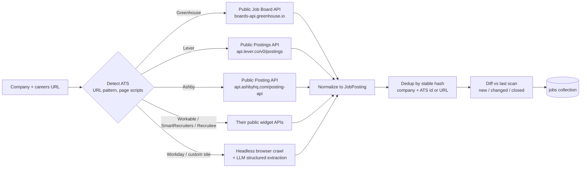
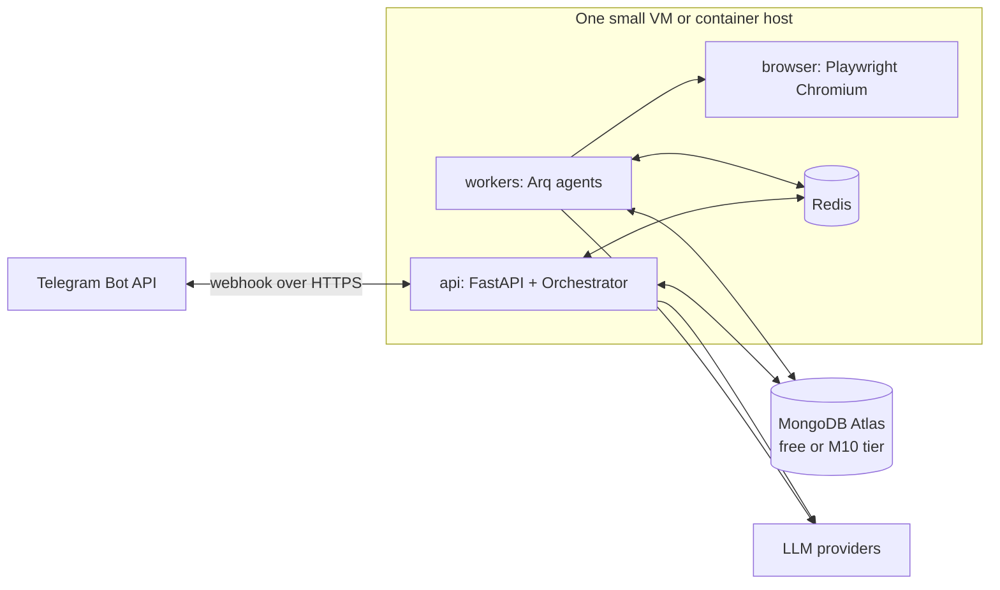

# 01 · System Architecture

> Status: **Draft for review** · Scope: design only, no implementation yet

## 1. Goals

| # | Goal | What "done" looks like |
|---|------|------------------------|
| G1 | Chat-first control | Everything is driven from a messaging app (Telegram first, WhatsApp/Slack pluggable). |
| G2 | Company → roles | Given a company + careers URL, list every open role and keep the list fresh. |
| G3 | Honest matching | Only surface roles that are a strong or good fit with the candidate's real background, with a written reason. |
| G4 | Apply on my behalf | Fill and submit applications using the stored resume and profile. |
| G5 | Ask, don't guess | Any detail the system doesn't know (or isn't sure of) is asked in chat, then remembered. |
| G6 | Two modes | **Review mode** (approve each submission) and **Auto mode** (submit within guardrails), switchable any time. |
| G7 | Smart memory | A Memory Manager decides what is worth remembering and classifies it as profile info, preference, reusable answer, event or know-how. |
| G8 | Model-agnostic | Any LLM provider (Claude, OpenAI, Gemini, …) per task, swappable by config. |

**Non-goals (v1):** scraping LinkedIn/Indeed, bypassing CAPTCHAs or bot protection, inventing experience, mass "spray and pray" applying.

## 2. High-level architecture



### Layer responsibilities

| Layer | Responsibility | Key tech |
|-------|----------------|----------|
| **Channel layer** | Turn each platform's webhook into one standard `InboundMessage`, and one `OutboundMessage` back into platform format (text, buttons, files). Nothing else in the system knows which app you use. | FastAPI, python-telegram-bot, WhatsApp Cloud API, Slack Bolt |
| **Orchestration** | Understand what you want (intent), check mode and policies, start or resume workflows, and hold conversation state. | LangGraph (supervisor graph + checkpointer in MongoDB) |
| **Specialist agents** | Each does one job well and runs as a queued worker so slow work (crawling, form filling) never blocks the chat. | LangGraph sub-graphs, Arq workers |
| **Memory Manager** | The only component allowed to write long-term memory about you. Decides what to store, how to classify it and how to serve it back. See [04-memory-manager.md](04-memory-manager.md). | Python service + MongoDB + Atlas Vector Search |
| **Platform services** | Model routing and fallbacks, queues, browsers, secrets, tracing. | LiteLLM, Redis, Playwright, Vault / encrypted Mongo fields |
| **Data layer** | System of record. See [05-data-model.md](05-data-model.md). | MongoDB Atlas, GridFS/S3 |

## 3. The agents

| Agent | Triggered by | Reads | Writes | Model tier |
|-------|--------------|-------|--------|-----------|
| **Orchestrator** | Every inbound message, every agent result | Conversation state, settings | Tasks to queue, workflow state | Small and fast (intent classification) |
| **Concierge** | Agent needs to tell or ask you something | Pending questions, digests | Outbound messages, `pending_questions` | Small |
| **Profile Agent** | Resume upload, `/profile`, onboarding | Resume file | Candidate memories (through the Memory Manager only) | Mid (structured extraction) |
| **Discovery Agent** | New company added, schedule (e.g. every 24 h) | `companies` | `jobs` (normalized, de-duplicated) | Small (only for HTML extraction fallback) |
| **Matching Agent** | New or changed jobs | Profile block, preferences, `jobs` | `matches` (score, label, reasons, gaps) | Mid |
| **Application Prep Agent** | You tap **Apply**, or auto mode picks a match | Job, profile, answer bank | Application packet (field-value map, cover note), info requests | Mid / strong |
| **Applier Agent** | Packet ready (and approved in review mode) | Packet, vault (logins), ATS playbooks | Form submission, screenshots, `applications` status, procedural memory | Strong + vision |

Agent details, prompts and tools will be specified per agent at the start of development. The contracts above are what this design commits to.

### 3.1 Discovery strategy (cheapest reliable path first)



Many ATS vendors publish keyless JSON job-board endpoints, which are far more stable than scraping HTML. The browser plus LLM path is the fallback for custom sites and Workday.

### 3.2 Matching (three stages, so it's cheap and explainable)

1. **Hard filters (no LLM):** location and remote rules, work authorization, seniority band, excluded companies and keywords. These come from *confirmed* preferences only.
2. **Semantic pre-rank:** embedding similarity between the job description and the profile summary, to drop obvious mismatches.
3. **LLM rubric scoring:** a structured score (0–100) on skills, years and seniority, domain, title alignment, and must-have gaps, with a short written reason.
   Labels: **Strong ≥ 80**, **Good 65–79**, **Stretch 50–64** (shown only if you opt in), below 50 hidden. Thresholds are configurable.

### 3.3 Operating modes

| | Review mode (default) | Auto mode |
|---|---|---|
| Shortlist | Digest with **Apply / Skip / Details** buttons | Same digest, marked "auto-queued" |
| Before submit | Summary + screenshot, waits for **✅ Submit / ✏️ Edit / ❌ Cancel** | Submits only if **every** auto-gate passes, otherwise falls back to review |
| Auto-gates | n/a | Score ≥ auto threshold (default 80) · all required fields resolved with high confidence · no special-category or free-text-essay fields left unreviewed · daily cap (e.g. 10) and per-company cap (e.g. 2 per 30 days) not hit · domain matches the company's known ATS |
| Kill switch | `/pause` stops all submissions instantly | same |

Switch with `/mode review` or `/mode auto`. Every change is logged in the audit log.

## 4. Pluggable model layer

All LLM calls go through one `LLMGateway` interface built on LiteLLM, which offers a single OpenAI-style API across Anthropic, OpenAI, Google and others. Models are chosen **per task** in config:

```yaml
llm:
  tasks:
    intent_router:      { model: "anthropic/claude-haiku-5-5",  fallback: "openai/gpt-mini-latest" }
    memory_extraction:  { model: "google/gemini-flash-latest",  fallback: "anthropic/claude-haiku-5-5" }
    resume_parsing:     { model: "anthropic/claude-sonnet-5-5" }
    job_matching:       { model: "openai/gpt-latest" }
    application_prep:   { model: "anthropic/claude-sonnet-5-5" }
    browser_applier:    { model: "anthropic/claude-opus-5-5",   needs_vision: true }
  embeddings:           { model: "voyage/voyage-3-large" }   # any provider; fixed per index
  budgets:
    monthly_usd_cap: 30
```

*(Model names are placeholders, to be fixed at build time.)* The embedding model must stay fixed for a vector index; changing it means re-embedding.

## 5. Deployment (single user, low cost)



* `docker compose` with three services: `api`, `worker`, `redis`. The browser runs inside the worker image.
* Atlas Vector Search lets one MongoDB cluster hold both documents and embeddings, so there's no separate vector DB.
* Backups: Atlas snapshots. Secrets: environment variables in dev, a secrets manager in prod.

## 6. Key design decisions (proposed, for your approval)

| ID | Decision | Why | Alternative considered |
|----|----------|-----|------------------------|
| D1 | Telegram first, channel-adapter pattern | Free, inline buttons, file upload, no 24 h window | WhatsApp first (cost + Meta setup), Twilio (adds a fee on top of Meta) |
| D2 | LangGraph for orchestration | Durable state, human-in-the-loop interrupts, MongoDB checkpointer and store integrations | CrewAI, plain asyncio |
| D3 | MongoDB Atlas as the only database (+ Vector Search) | You asked for MongoDB; one store for docs, memory and vectors | Postgres + pgvector, a separate vector DB |
| D4 | A dedicated Memory Manager service is the only writer of user memory | Consistent classification, prevents prompt-injected "memories" from web pages | Each agent writes its own memory (Letta-style self-editing) |
| D5 | Never hard-delete memory on update: supersede with time validity | Audit trail, undo, "what did I tell you before?" | Overwrite in place |
| D6 | Public ATS APIs before browser scraping | Stable, fast, within terms | Scrape everything with a browser |
| D7 | Review mode is the default, auto mode is opt-in with gates | Mistakes on real applications are costly and can't be undone | Auto by default |
| D8 | LiteLLM gateway with per-task model config | Provider-agnostic, fallbacks, cost tracking | Direct SDKs per provider |
