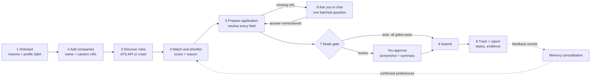
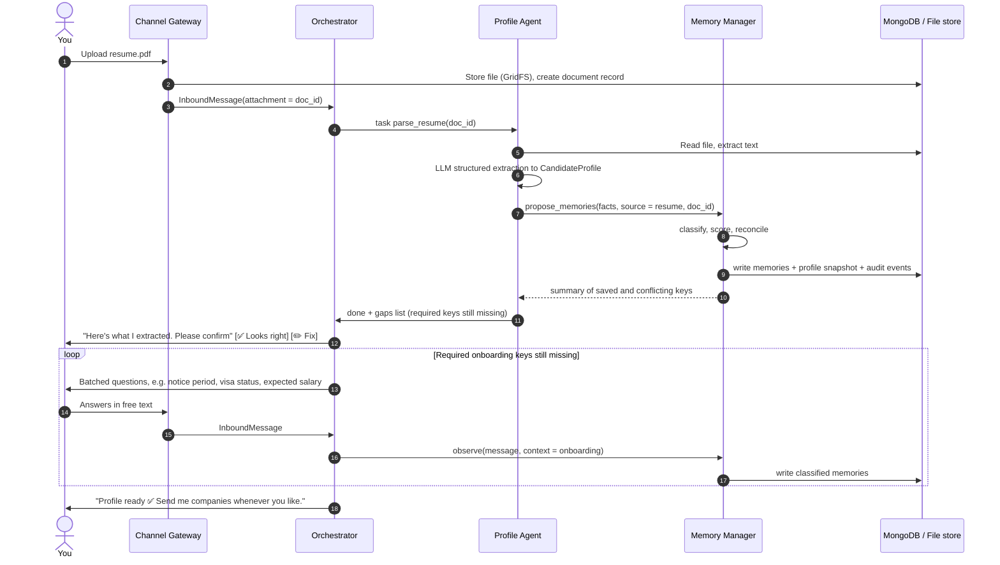
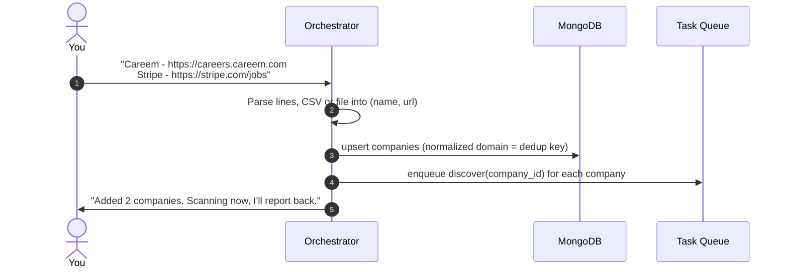
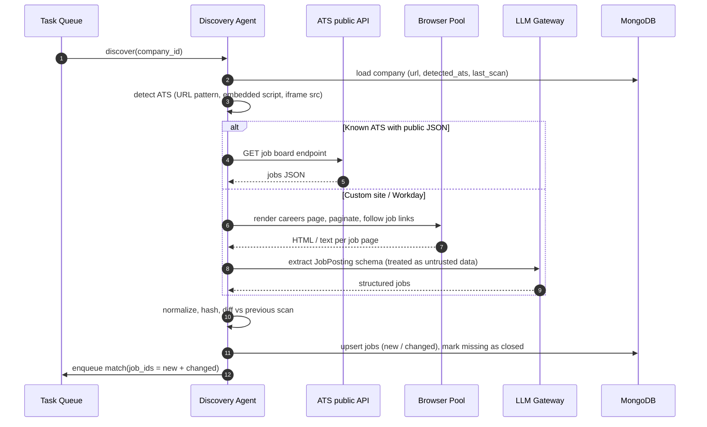
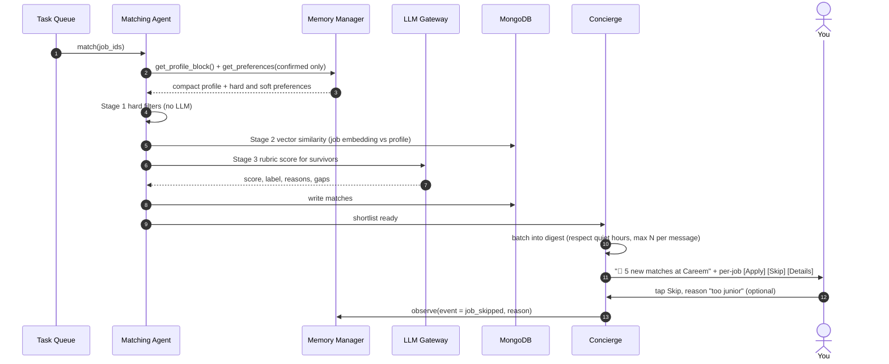
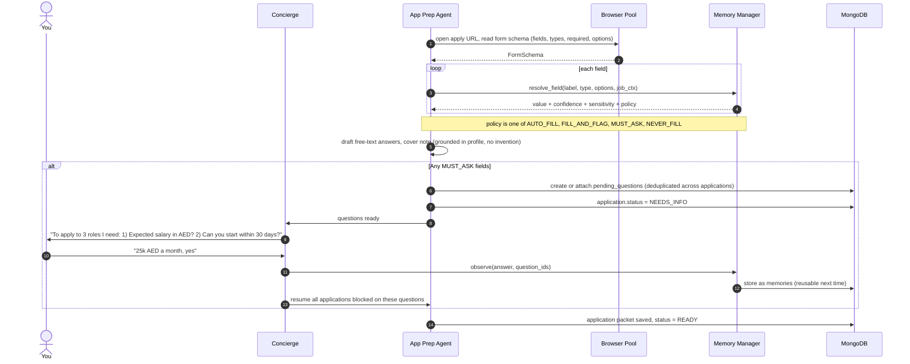
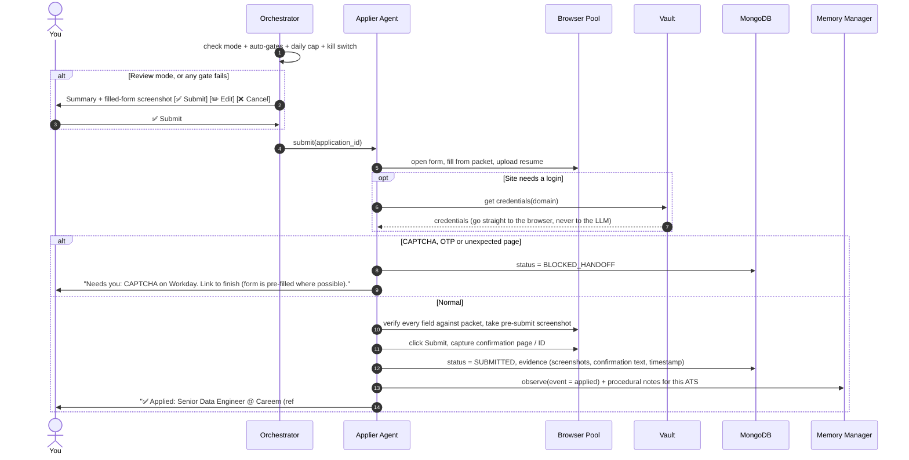
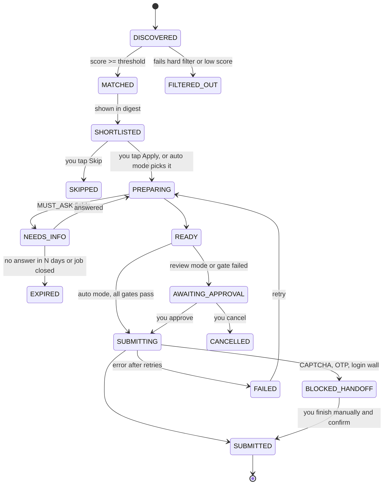
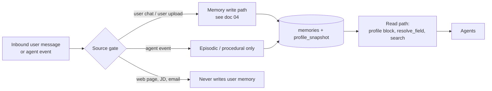

# 02 · Data Flows

> Status: **Draft for review**

This document traces how data moves through the system for each workflow. All chat messages pass through the **Channel Gateway** (normalized to `InboundMessage` / `OutboundMessage`) and the **Orchestrator**. Every user message is also handed to the **Memory Manager write path** asynchronously, so the chat reply never waits on it.

## 0. End-to-end overview

## 1. Onboarding: resume and profile

**Data produced:** `documents`, `chunks` (resume chunks with embeddings for RAG), `memories` (profile facts with `source = resume`, then `source = user_chat`), `profile_snapshot`.

The **required onboarding keys** are defined in the schema registry (see [04](04-memory-manager.md#4-schema-registry)): legal name, email, phone, current location, work authorization per target country, notice period, expected salary range and currency, target titles, target locations, remote preference, LinkedIn URL.

## 2. Adding companies

## 3. Discovery: careers page to jobs

Scheduled re-scan: each company every 24 h by default, configurable. Only **new or changed** jobs go on to matching, so you're never notified twice about the same role.

## 4. Matching and shortlist

Skip reasons are **episodic memories**. The nightly consolidator may turn repeated patterns into a *proposed* preference, which you confirm before it's used as a filter.

## 5. Application preparation and the missing-info loop

This is where the Memory Manager earns its keep: every form field is resolved from memory, and only truly unknown or unsafe fields get asked.

**Question de-duplication:** if five applications all need "expected salary (AED)", one `pending_question` is created and linked to all five. One answer unblocks all of them.

## 6. Submission (review mode and auto mode)

## 7. Application status state machine

## 8. Memory flow on every message (summary)

## 9. Data inventory by flow

| Flow | Creates / updates | Sensitive data touched |
|------|-------------------|------------------------|
| Onboarding | documents, chunks, memories, profile_snapshot | Contact, salary, visa |
| Add companies | companies | None |
| Discovery | jobs | None (public postings) |
| Matching | matches | Profile summary (sent to LLM) |
| Prep | applications.packet, pending_questions | All fields required by the form |
| Submission | applications.evidence, memories (episodic, procedural) | Credentials (vault to browser only) |
| Consolidation | memories (proposed preferences), answer bank | Same as stored |
