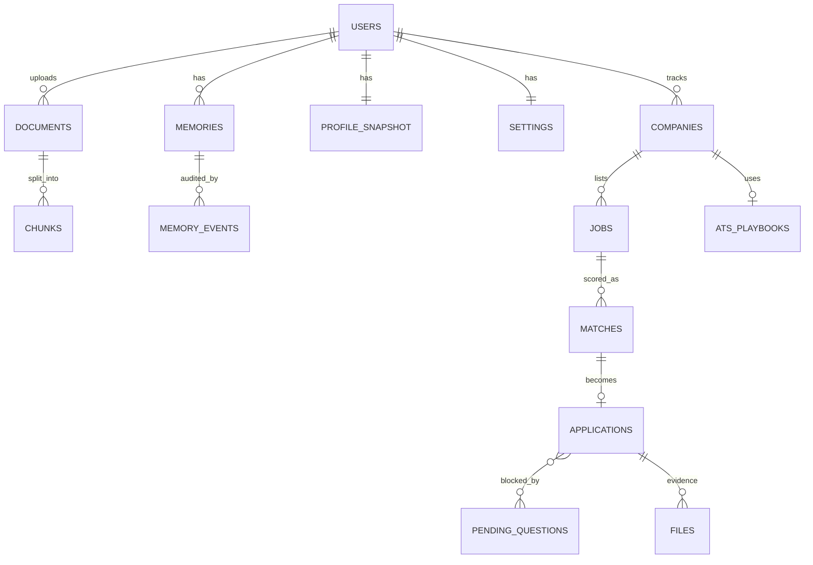

# 05 · Data Model (MongoDB Atlas)

> Status: **Draft for review**. Single database `jobhunt`. All collections carry `user_id` (single-user today, multi-user-ready).

## 1. Entity relationships



## 2. Collections

| Collection | Purpose | Key fields | Indexes |
|-----------|---------|-----------|---------|
| `users` | Account + channel identities | `channels[{type, external_id}]`, `timezone` | `channels.type + channels.external_id` unique |
| `settings` | Mode and policies | `mode: review or auto`, `auto_threshold`, `daily_cap`, `per_company_cap`, `quiet_hours`, `paused` | `user_id` unique |
| `documents` | Uploaded files metadata | `kind: resume / cover_letter / other`, `variant_name`, `gridfs_id`, `parsed_text`, `active` | `user_id + kind` |
| `chunks` | RAG chunks of resumes | `document_id`, `text`, `embedding[]`, `section` | **Vector index** on `embedding`, filter `user_id` |
| `memories` | All long-term memory items (see [04 §8](04-memory-manager.md#8-memory-document-shape-mongodb)) | `type`, `key`, `value`, `scope`, `sensitivity`, `status`, `valid_from/to`, `embedding?` | `user_id + key + status`, `user_id + type + status`, **vector index** on `embedding` (filters: `user_id`, `type`, `status`) |
| `profile_snapshot` | Materialized current view of active keyed facts | `facts: {key: {value, memory_id, confirmed_at}}`, `profile_block_text`, `version` | `user_id` unique |
| `memory_events` | Audit log of every memory op | `op: ADD / SUPERSEDE / MERGE / NOOP / CONFLICT / DROPPED / FORGET / UNDO`, `memory_id`, `source`, `reason` | `user_id + ts` |
| `schema_registry` | Canonical keys, aliases, sensitivity | `key`, `type`, `sensitivity`, `aliases[]`, `alias_embeddings[]` | `key` unique, vector index on aliases |
| `companies` | Tracked companies | `name`, `careers_url`, `domain`, `ats: {vendor, board_token}`, `last_scan`, `scan_status` | `user_id + domain` unique |
| `jobs` | Normalized postings | `company_id`, `ats_job_id`, `hash`, `title`, `location`, `remote`, `description`, `apply_url`, `posted_at`, `status: open / closed`, `embedding[]` | `company_id + hash` unique, `status`, vector index |
| `matches` | Fit results | `job_id`, `score`, `label`, `reasons[]`, `gaps[]`, `model`, `rubric_version` | `user_id + score`, `job_id` unique per user |
| `applications` | Lifecycle + packet + evidence | `match_id`, `status` (see state machine), `packet`, `approvals[]`, `evidence{screenshots[], confirmation}`, `attempts[]` | `user_id + status`, `job_id` unique (one application per job) |
| `pending_questions` | Info requests to you | `canonical_key?`, `question_text`, `application_ids[]`, `status: open / answered / expired`, `asked_at` | `user_id + status`, `canonical_key + status` |
| `ats_playbooks` | Procedural memory per ATS / domain | `vendor`, `domain`, `form_selectors`, `quirks[]`, `success_rate` | `domain` unique |
| `llm_usage` | Cost tracking | `task`, `model`, `tokens_in/out`, `usd`, `ts` | `ts`, `task` |
| `checkpoints` | LangGraph short-term state (MongoDB checkpointer) | managed by the library | managed, TTL on stale threads |
| GridFS `files` | Resumes, screenshots, confirmations | | |

## 3. Encryption and retention

| Data | Protection | Retention |
|------|-----------|-----------|
| S2 memory values | Client-side field-level encryption (MongoDB CSFLE / Queryable Encryption, or app-level AES-GCM with a KMS key) | Until you forget it |
| S3 memory values | Same, plus a separate key | Until you forget it |
| Credentials (S4) | Vault only (cloud secrets manager or an encrypted `vault` collection with its own key) | Until removed |
| Screenshots / evidence | GridFS / S3, private | 12 months, configurable |
| Raw chat messages | `checkpoints` + message log, PII-redacted copy for traces | 90 days |
| LLM traces | Langfuse / LangSmith with redaction | 30 days |

## 4. Example: `jobs` document

```json
{
  "_id": "job_9f2c",
  "user_id": "u_1",
  "company_id": "cmp_careem",
  "source": { "vendor": "greenhouse", "ats_job_id": "4471223", "fetched_via": "api" },
  "hash": "sha256:company+vendor+ats_job_id",
  "title": "Senior Data Engineer",
  "department": "Data Platform",
  "location": { "raw": "Dubai, UAE", "city": "Dubai", "country": "AE" },
  "work_mode": "hybrid",
  "employment_type": "full_time",
  "description_md": "...",
  "apply_url": "https://boards.greenhouse.io/...",
  "posted_at": "2026-11-20",
  "first_seen_at": "2026-11-23T09:00:00Z",
  "last_seen_at": "2026-11-23T09:00:00Z",
  "status": "open",
  "embedding": [0.012, -0.03]
}
```
