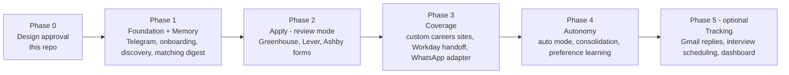

# 08 · Delivery Roadmap

> Status: **Draft for review**. Development starts only after these designs are approved.



| Phase | Scope | Exit criteria |
|-------|-------|---------------|
| **0 · Design** | These docs | You approve architecture, data flows, memory design |
| **1 · Foundation + Memory** | Repo scaffold, docker compose, Telegram adapter, Orchestrator, LLM Gateway, Memory Manager (write + read paths, registry), Profile Agent, Discovery (ATS APIs), Matching, digests | Resume → profile in under 2 min. 10 companies scanned. Digest with reasons. Memory test-set targets met ([04 §11](04-memory-manager.md#11-how-well-measure-it-acceptance-criteria-for-the-build-phase)). |
| **2 · Apply (review)** | Prep Agent, `resolve_field`, pending-question loop, Applier for Greenhouse / Lever / Ashby, approval cards, evidence capture | 10 real applications submitted in review mode with zero wrong fields |
| **3 · Coverage** | Browser crawl + LLM extraction for custom sites, generic form agent, Workday handoff flow, WhatsApp Cloud API adapter | 80 % of your target companies discoverable. WhatsApp parity with Telegram. |
| **4 · Autonomy** | Auto mode + gates + caps, nightly consolidator, proposed preferences, answer-bank clustering, staleness re-confirmation | 2 weeks of auto mode with no incorrect submissions |
| **5 · Tracking (optional)** | Gmail connector to detect replies and rejections, status updates, small web dashboard | n/a |

## Proposed repository layout (for Phase 1)

```
Job-hunt-agents/
├── docs/                    # these design docs
├── app/
│   ├── channels/            # telegram.py, whatsapp.py, slack.py, base.py
│   ├── orchestrator/        # LangGraph supervisor graph, intents
│   ├── agents/              # profile/, discovery/, matching/, prep/, applier/, concierge/
│   ├── memory/              # manager.py, write_path/, read_path/, registry.yaml, consolidator.py
│   ├── llm/                 # gateway.py (LiteLLM), config.yaml
│   ├── browser/             # playwright pool, ats scripts
│   ├── db/                  # mongo models, indexes, migrations
│   └── api/                 # FastAPI webhooks, health
├── workers/                 # Arq worker entrypoints
├── tests/                   # unit, memory test set, poisoning tests
├── docker-compose.yml
└── .env.example
```
